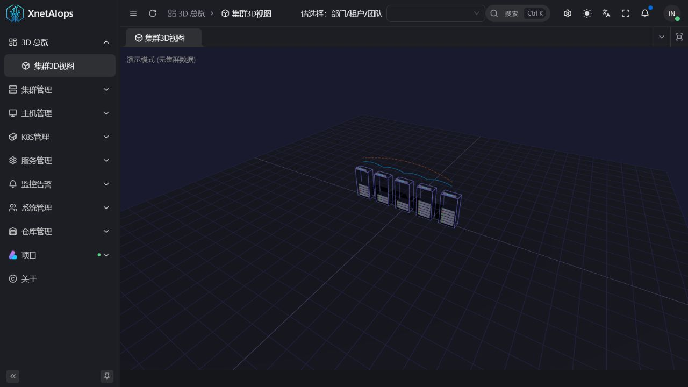
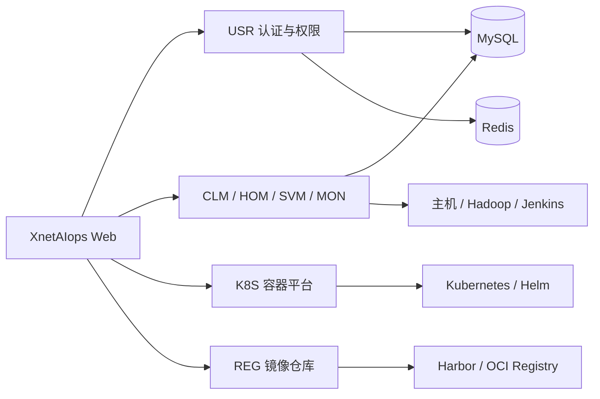

<div align="center">

# XnetAIops

**面向基础设施、服务与 Kubernetes 的智能运维平台**

[](https://github.com/synapxnet/XnetAIops/releases/tag/v1.3.0)
[](https://www.oracle.com/java/)
[](https://spring.io/projects/spring-boot)
[](./LICENSE)

[前端仓库 XnetAIops-web](https://github.com/synapxnet/XnetAIops-web/tree/v1.3.0) · [OpenXnet 开源社区](https://openxnet.synapxnet.com) · [查看许可](./LICENSE)

</div>

## 主线开发

基于 v1.3.0 的平台功能继续演进，保留驻场 Agent、知识与 Skill 工作台、跨域取证、受控执行、独立验证、审计与恢复。主线默认不加载比赛账号、组织、固定场景或竞赛服务地址。

[主线迁移范围](./docs/MAINLINE-TRANSITION.md) · [历史发布](https://github.com/synapxnet/XnetAIops/releases)



## 项目简介

XnetAIops 是由 **SynapXnet 团队**开源的智能运维平台，面向服务器、基础软件、业务服务、Kubernetes 集群与镜像仓库等运维对象，提供从资源纳管、部署交付到监控告警的统一工作台。

本仓库是平台后端，与 [XnetAIops-web](https://github.com/synapxnet/XnetAIops-web/tree/v1.3.0) 前端仓库共同组成企业级、多租户、前后端分离系统。项目采用模块化微服务架构，将集群生命周期、主机资产、服务编排、可观测性、租户权限控制等能力拆分为独立服务，便于按场景组合、扩展和二次开发。

## 项目优势

- **企业多租户**：通过用户、角色、权限与资源边界服务不同组织和团队。
- **前后端分离**：Web 控制台和后端服务独立演进，可按现有基础设施灵活集成。
- **模块化交付**：各业务服务边界清晰，支持整体部署或按场景扩展。
- **工程化部署**：提供 Maven 与 Docker Compose 工作流，便于本地验证和容器化交付。
- **持续更新**：SynapXnet 团队会持续完善自动化、可观测性、安全性与文档。

## 核心能力

| 模块 | 服务目录 | 说明 |
| --- | --- | --- |
| 3D 总览 | Web 展示层 | 以三维视图呈现集群、节点及拓扑关系，快速建立基础设施全局视角 |
| CLM 集群管理 | `aiops-clm-service` | 管理集群生命周期，支持 MySQL、Redis、Hadoop、Jenkins 等基础组件的部署与运维 |
| HOM 主机管理 | `aiops-hom-service` | 管理主机、机架、SSH 连通性与基础设施资产，为自动化部署提供资源底座 |
| SVM 服务管理 | `aiops-svm-service` | 提供服务概览、命令中心、框架管理及服务启停、部署和生命周期管理 |
| MON 监控告警 | `aiops-mon-service` | 汇聚监控看板、告警历史与告警规则，帮助定位基础设施和服务异常 |
| K8S 容器平台 | `aiops-k8s-service` | 管理集群、节点、命名空间、工作负载、存储、网络、RBAC、Helm、流水线与部署计划 |
| REG 仓库管理 | `aiops-reg-service` | 管理镜像仓库、项目、制品标签、同步任务、仓库端点与部署日志 |
| USR 系统管理 | `aiops-usr-service` | 提供登录认证、用户、角色与访问权限管理，支撑平台级权限控制 |

## 技术架构



后端基于 Java 17、Spring Boot 3.4.6 与 MyBatis 构建，使用 Maven 管理多模块工程，并通过 Docker Compose 组织前端代理和各微服务容器。

## 目录结构

```text
XnetAIops/
├── aiops-clm-service/    # 集群生命周期
├── aiops-hom-service/    # 主机与机架资产
├── aiops-svm-service/    # 服务管理
├── aiops-mon-service/    # 监控告警
├── aiops-usr-service/    # 用户与权限
├── aiops-k8s-service/    # Kubernetes 管理
├── aiops-reg-service/    # 镜像仓库管理
├── nginx/                # 反向代理配置
├── XnetAIops.sql         # 数据库初始化脚本
└── docker-compose.yml    # 容器编排
```

## 主线构建

使用当前主线源码，环境为 JDK 17、Maven 3.9、MySQL 8.x、Redis 7.x；后端使用 Spring Boot 3.4.6 与 MyBatis。历史发布与主线配置相互独立。

```bash
cd XnetAIops
mvn -B -DskipTests package
```

构建产物位于各服务 `target/*-1.3.0.jar`，这一步只构建。测试命令、跳过项与已知边界见上方源码交付说明。

### 部署准备与边界

1. 准备外部 MySQL 和 Redis，按数据库实际状态审阅 `XnetAIops.sql`、K8s/DevOps 表和 `database/migrations`，先备份再执行所需初始化或迁移；仓库并非自动初始化的整套数据库镜像。
2. 从 `.env.example` 创建本地配置，填写数据库、Redis、`K8S_ENCRYPTION_KEY` 等。USR 要求 `JWT_SECRET` 以及企业短信网关配置，Compose 会传入这些变量。
3. 配套前端也使用同一主线源码并构建，将 `WEB_DIST_PATH` 指向其 `apps/web-antd/dist`。通用 Compose 的 Web 默认端口为 `81`；内部 USR 为 `9185`，CLM/HOM/SVM/MON/K8S/REG 分别为 `9181/9182/9183/9184/9186/9187`。公网经 HTTPS 网关访问，不把开发端口当作线上地址。
4. 通用 Compose 只覆盖原生平台服务，不包含驻场 Agent、AgentTeams、审批服务或 reader/checkpoint 分工。驻场独立服务来自 OpenXnet 固定版本，须另配 `/api/resident/v1/` 网关转发；参考源码交付说明，不能声称单条 Compose 已复现完整协作链路。

完成配置后再在隔离环境使用 `docker compose up -d --build` 和 `docker compose ps`。不要对已有部署直接套用通用 Compose 覆盖当前状态。

## 部署与登录

使用当前部署环境提供的访问地址，网页 API 默认同源。登录调用 POST /api/usr/sms-code 发送一次性验证码，再使用 POST /api/usr/login 登录；身份、驻场状态接口分别为 /api/usr/user/info、/api/resident/v1/status。

管理员需创建真实账号与组织成员关系，并配置 Redis、JWT_SECRET、XNET_SMS_GATEWAY_URL 和 XNET_SMS_GATEWAY_TOKEN。主线不预置任何通用验证码或公共登录账号。验证码 5 分钟有效、60 秒发送间隔、最多 5 次错误、成功后立即销毁。短信网关接收 POST JSON {phone, code, purpose: "login", expiresInSeconds: 300}，通过 Bearer token 鉴权，必须返回 HTTP 2xx 与 {"accepted": true}。未配置或发送失败时明确报错。

驻场 Agent、审批、模型服务沿用各自配置与权限边界。前端跨平台导航使用 VITE_XNET_AIOPS_URL、VITE_XNET_DATAOPS_URL、VITE_XNET_MLOPS_URL；未配置则不显示对应外链。

存量比赛预置身份可使用 [`database/maintenance/archive-competition-identities.sql`](database/maintenance/archive-competition-identities.sql) 先预览，再在独立备份后的维护窗口执行。它仅匹配未改变的种子身份，保留审计主体和业务资源，不按名称或手机号批量删除。详细迁移范围见 [`docs/MAINLINE-TRANSITION.md`](docs/MAINLINE-TRANSITION.md)。


## SynapXnet 开源生态

XnetAIops 是 SynapXnet 开源体系的一部分。更多团队项目、技术方向与社区动态请访问 [OpenXnet](https://openxnet.synapxnet.com)。

## 参与贡献

欢迎通过 Issue 提交缺陷、需求和改进建议。提交代码前，请保持模块边界清晰，并为关键业务变更补充必要的测试与说明。

## 开源许可

本项目基于 [MIT License](./LICENSE) 开源。你可以自由使用、修改和分发本项目，但须保留原始版权与许可声明。
